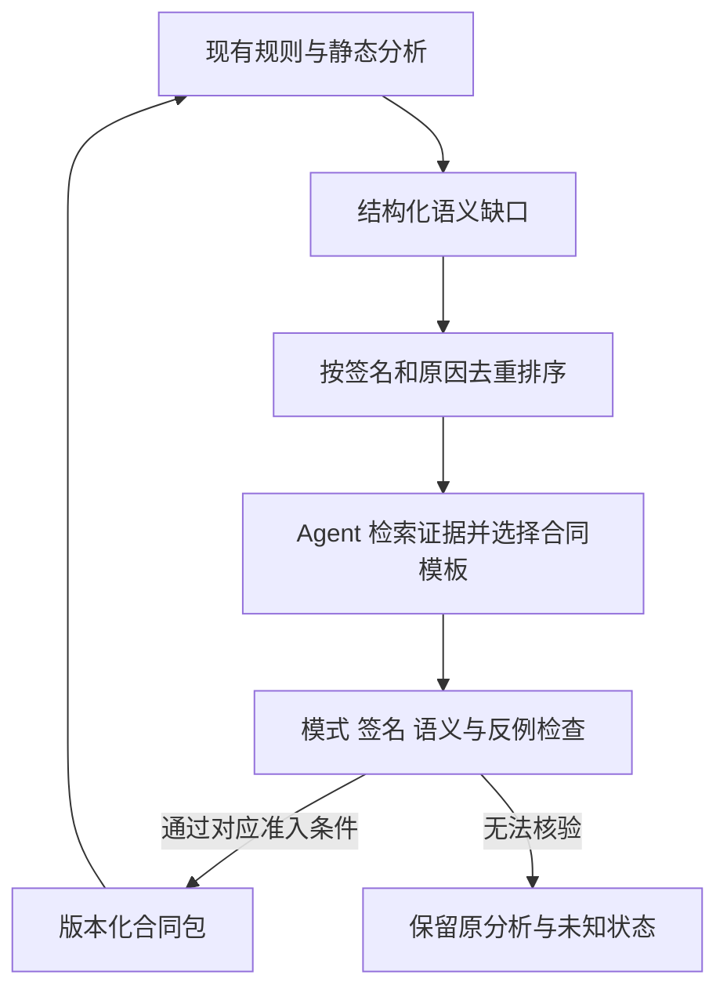

# 规则驱动的 Agent 辅助静态分析提升方案

调研日期：2026-10-04。源码基线：`f5f686e`。状态：设计提案，尚未实现或进行效果实验。

## 1. 结论与推荐范围

当前项目适合引入 Agent，但最合适的位置是**分析器外围的语义合同补全与验证流程**：分析器发现缺口，Agent 查阅 SDK 声明、文档和局部源码并提出候选，确定性检查器验证后将候选编译成规则，最终仍由现有静态分析引擎传播事实和产生诊断。

建议以资源释放义务为首个落点，按以下优先级推进：

| 方案 | 目标 | Agent 的作用 | 复杂度判断 | 优先级 |
| --- | --- | --- | --- | --- |
| A. 缺口驱动的资源合同补全 | 补足 API 规则，减少规则遗漏导致的漏报 | 检索证据、选择合同模板、生成候选与反例 | 低至中；首先限制在现有事实域能表达的合同 | 首期 |
| B. 可验证的包装函数摘要 | 降低重复传播成本，改善部分边界语义 | 提出值得摘要化的函数及其效果 | 中；需要受限验证器、流函数接入和失效机制 | A 完成且测得热点后 |
| C. 诊断驱动的条件合同精化 | 减少 guard、条件释放导致的误报 | 从重复误报中提炼可复用前置条件 | 中至高；限定简单条件时可控 | 后续可选 |

复杂度是基于当前接口的工程判断，不是工时承诺。A 的主要潜力是准确性和建模效率；B 才直接针对静态求解效率。引入 Agent 本身不会让 IFDS 更快，也不能预先承诺准确率提升幅度。

推荐研究主线为：**不确定性驱动、证据约束的资源语义合同补全，以及验证后合同的复用**。单纯“LLM 生成规则”已有大量先例，不能据此主张原创；差异点应落在缺口归因、合同准入、异常/异步边界以及跨项目复用的实证结果上。

## 2. 当前项目已经具备什么

以下为本轮源码检查结果，未用历史测试通过记录替代当前验证。

| 当前能力 | 源码依据 | 对方案的影响 |
| --- | --- | --- |
| 资源已使用规则 IFDS，工程支持 `resourceRules` 注入 | [ProjectAnalyzer](../src/application/ProjectAnalyzer.ts)、[ResourceRunner](../src/analysis/resourceleak/ResourceRunner.ts) | 可复用入口，不需要另建 Agent 检测器 |
| 10 个默认资源家族，按 SDK 模块、类和完整签名绑定 | [HarmonyResourceRules](../src/analysis/resourceleak/rules/HarmonyResourceRules.ts) | 增量补齐缺口；已有规则不算新贡献 |
| 规则表达句柄位置、Promise/回调获取、显式句柄投影和 nullify | [ResourceRule](../src/analysis/resourceleak/rules/ResourceRule.ts) | 是首期合同编译目标；不能表达任意条件和时序 |
| 输出绑定失败、已知未支持家族、创建/释放调用覆盖 | [ResourceCapabilities](../src/analysis/resourceleak/rules/ResourceCapabilities.ts)、[ResourceRunner](../src/analysis/resourceleak/ResourceRunner.ts) | 可作为缺口收集起点，但未支持家族列表不是实际使用清单 |
| 未知外部转交、可选回调、调用深度限制可能产生未知所有权 | [ResourceProblem](../src/analysis/resourceleak/ResourceProblem.ts) | 必须区分未知原因，不能统一解释成缺规则 |
| 空指针已有返回、容器、ArkUI、SDK、异步边界摘要及缓存 | [NullnessLibraryRegistry](../src/analysis/nullness/library/NullnessLibraryRegistry.ts)、[ProjectMethodReturnSummary](../src/analysis/nullness/library/ProjectMethodReturnSummary.ts) | 优先复用摘要体系，避免重复实现已有返回推断 |
| IFDS 已有调用/出口摘要、哈希去重及统计 | [SummaryStore](../src/ifds/SummaryStore.ts)、[DataflowSolver](../src/ifds/DataflowSolver.ts)、[SolverStatistics](../src/ifds/SolverStatistics.ts) | “增加缓存”不是充分方案；必须说明缓存了哪些现有缓存之外的工作 |
| 闭包注册合同已独立，生命周期未知 owner/route 保守回退 | [RegistrationRules](../src/analysis/closure/RegistrationRules.ts)、[生命周期说明](analysis/lifecycle.md) | 注册取消与资源释放不能混为一个规则域；Agent 不能猜测时序后裁边 |

需要特别注意两个接入限制：

1. `resourceRules` 当前是**替代默认规则集**，不是追加。新规则包加载器必须显式合并默认集、检查冲突，避免增加一条规则却丢掉原有覆盖。
2. 现有资源规则构造检查验证 ID、非空 API、参数索引等基本形状，不等于验证 API 存在、索引小于实参数、句柄类型匹配或语义正确。候选准入需要补充这些检查。

本轮没有性能剖析，不能断言当前瓶颈是 IFDS、SDK 解析还是生命周期 CFG。方法级传播热点也尚未测得。

## 3. 借鉴哪些已有设计与实现

### 3.1 IRIS：先补规格，再交给静态引擎

IRIS 用 LLM 标注 API 语义，再交给 CodeQL 分析，并包含告警上下文筛选。[论文](https://arxiv.org/abs/2405.17238)与[项目](https://github.com/iris-sast/iris)支持这种职责划分。

本轮检查了其 [`src/neusym_vul.py`](https://github.com/iris-sast/iris/blob/main/src/neusym_vul.py)：`SAPipeline` 包含外部 API 候选提取、按完整签名去重、标签缓存，以及模型文件输出。可借鉴“静态提取候选 → 语义标注 → 模型编译 → 引擎执行”的管线；缓存也应以 API 合同为单位，而非每条告警重复询问模型。

项目适配：把 source/sink 标注替换成“创建/释放/句柄投影”等资源合同。告警后处理只作为审查意见；不能直接把模型判断当成安全证明。

### 3.2 InferROI：提取资源行为，再检查控制流

InferROI 将资源意图推断与静态路径检查结合，和本项目的资源方向最接近。[论文](https://arxiv.org/abs/2311.04448)。

本轮检查了 [`app/llm4leak.py`](https://github.com/cs-wangchong/InferROI-Replication/blob/main/app/llm4leak.py)：`detect` 依次获取模型答案、解析意图、构造 CFG，再调用 `prune`、`enumerate_paths` 与 `detect`。可借鉴行为提取与检测分离；本项目应将结果固化成签名和句柄位置明确的合同，继续复用 IFDS，不移植逐路径枚举。

### 3.3 CodeQL Models-as-Data：把模型作为受约束数据维护

CodeQL 提供通过数据扩展描述 source、sink 和 summary 的方式，并区分保持值与传播污点的摘要。[官方 JavaScript 模型文档](https://codeql.github.com/docs/codeql-language-guides/customizing-library-models-for-javascript/)。

项目适配：采用小型 JSON 合同、模式校验和固定解释器。Agent 选择已实现的操作，不生成任意 TypeScript 插件。资源、空指针、注册关系分别保留语义，不直接照搬污点摘要格式。

### 3.4 LLift 与 LLMDFA：只请求局部语义，交给工具核验

LLift 围绕初始化行为与使用位置的约束进行局部推理，可借鉴按疑点提供上下文的方式。[论文](https://www.cs.ucr.edu/~zhiyunq/pub/oopsla24_llift.pdf)、[实现仓库](https://github.com/seclab-ucr/LLift)。

LLMDFA 使用函数摘要，并通过合成代码调用解析器、定理证明器处理部分精确任务。[论文](https://arxiv.org/abs/2402.10754)、[实现与运行说明](https://github.com/chengpeng-wang/LLMDFA/blob/main/README.md)。项目适配取其“工具核验”的思路，先用受限 CFG/模板检查器；完整 SMT、任意脚本合成和 LLM 数据流解释器会扩大首期复杂度。

这两项本轮核对到论文和公开项目说明，未复现运行，也未逐模块审计其实现。

### 3.5 Infer 与 SemTaint：复用语义，而非每次重新解释

Infer 将捕获与分析分开，按函数/方法分析，并提供差分工作流。[官方说明](https://fbinfer.com/docs/next/infer-workflow/)。借鉴其阶段分离思路；本项目首期只持久化少量验证过的合同，不宣称已经实现全项目增量 IFDS。

SemTaint 将模型提取的污点规格提供给 CodeQL，包含库流摘要等信息。[论文](https://arxiv.org/abs/2601.10865)。它进一步说明“规格补全”已有先行工作；此处只参考规格层接口，不引入其多 Agent 主体架构。本轮未核验其可运行实现。

以上外部工作的效果数据不能直接外推到 ArkTS、HarmonyOS 或本项目。外部仓库链接指向可变分支；实际移植前需固定提交与许可证，本轮没有复制外部实现代码。

## 4. 总体设计：静态引擎主导的有限补全循环



Agent 的能力体现在有目标地查阅上下文、响应验证失败、修订候选，最终产物仍是可独立运行的规则数据。关闭 Agent 后，已准入合同仍可使用，分析器也可仅使用默认规则完成分析。

建议单 Agent、固定状态机，首期不增加向量数据库、训练流程或多 Agent 协作。每个缺口最多一次生成、两次修订；预算用尽保留未解决状态。这个上限是生成流程预算，不是额外要求反复运行整个测试套件。

建议独立工具接口：`listGaps`、`readDeclaration`、`readEvidence`、`readLocalSlice`、`submitContract`、`validateContract`。它们由程序限制到指定 SDK、依赖和源码范围；推理循环不进入 IFDS 的逐事实处理热路径。

## 5. 方案 A：缺口驱动的资源合同补全

### 5.1 先分清“没有规则”和“规则没有解析成功”

拟新增 `ModelGapCollector`，收集实际调用点、完整签名、已有覆盖和缺口原因。原因至少分为：

| 缺口 | 处理方式 |
| --- | --- |
| `missing-contract`：实际使用的 API 没有合同 | Agent 检索并提出候选 |
| `signature-binding-failed`：已有定义无法绑定 SDK | 优先检查 SDK 版本、导入和签名解析；不能放宽成同名匹配 |
| `unsupported-contract`：语义明确但当前事实域表达不了 | 记录能力缺口，不强行压成简单释放 |
| `unknown-external-effect`：句柄传入未知调用 | 检查函数体或可信库合同，不能根据名字推断释放 |
| `optional-callback`：执行关系不确定 | 保留未知，转入未来调度建模研究 |
| `depth-budget`：因调用深度限制丢失精度 | 检查是否适合方案 B；不能伪造 API 合同 |

现有 `unknown-ownership` 没有完整区分这些原因，需要增加结构化原因记录。原因和证据以有界元数据或旁表保存，不把长文本、完整路径或 Agent 对话放入 Fact 去重键。

不能只从已有告警找缺口：缺少创建规则时可能完全没有资源事实。还需扫描实际外部调用，与默认绑定集合及已知能力清单比较。方法名相似只能用于候选排序，不能决定资源语义。

### 5.2 Agent 产物与准入边界

候选使用以下信息：规则类别、模块/类/重载、句柄位置、正常/异常效果、同步/Promise/回调方式、证据位置和适用版本。完整签名由本地 Scene 绑定；模型不能凭空生成一个签名后直接启用。

准入分四层：

1. **格式检查**：固定操作白名单、字段类型、参数范围、重复 ID 和规则冲突。
2. **绑定检查**：API 在指定 SDK 中存在，句柄类型及位置一致，所有适用重载有明确解释；项目同名函数不能匹配 SDK 规则。
3. **语义依据**：有实现时用受限静态检查；无实现时依赖准确的版本化文档合同并进行维护者语义审查。声明文件中的返回类型不能证明必须释放，更不能证明异常时释放成功。
4. **正反例检查**：必须释放但未释放、正确释放、错误句柄、条件释放、异常、重载及异步边界。

建议状态为 `proposed`、`validated`、`reviewed`、`enabled`、`rejected`。`validated` 记录具体检查通过项，并不自动意味着完整语义证明。SDK 合同与源码包装摘要采用不同准入条件。

测试通过只能支持已测场景。不得让 Agent 自己生成的预期结果同时充当唯一 oracle；关键反例和期望由维护者/独立规格确定。

### 5.3 首期只接纳现有规则能表达的语义

先选择在目标项目中实际出现、SDK 文档明确、可以表达为简单创建/释放配对的 1–2 个家族。`ResourceCapabilities` 中的家族仅是候选池，不能因为位于清单里就假定容易建模。

例如 release 返回 Promise、成功取决于返回状态码、终止只启动异步清理、所有权转交由复杂容器决定时，现有 `ResourceRule` 可能不足。此时标记 `unsupported-contract`，不要将“调用了释放方法”直接升级为“义务必然解除”。Worker termination 等还可能属于其他分析域，需要先确定合同归属。

规则包加载时：解析默认集 → 按 ID/完整签名检查冲突 → 合并明确允许的新增合同 → 将最终数组传给 `ResourceRunner`。冲突不得依赖隐含加载顺序覆盖。默认清单的 `unsupportedApiFamilies` 也需与生效合同协调，避免新增支持后报告仍表示不支持。

### 5.4 预期价值与限制

A 有机会提高未覆盖 API 的 Recall，并减少部分未知边界；是否提高 Precision 取决于合同是否足够准确。新增规则也可能带来更多误报和更高运行成本，应同时计入。

创新候选是“由缺口原因选择建模任务 + 以证据约束模板 + 用反例约束准入 + 合同跨项目复用”，而非 API 名称分类本身。需要与人工补规则、纯静态模板提取和一次性 LLM 提示比较，才能证明 Agent 循环的额外价值。

## 6. 方案 B：可验证的包装函数摘要

### 6.1 为什么还可能有优化空间

IFDS 的 `SummaryStore` 已复用同一求解过程中的入口事实到出口结果，但不同事实上下文、不同 root 或新一次运行仍可能有成本。拟议摘要将简单包装函数转换成按参数角色解释的固定效果，尝试减少方法内部传播，而不是另加一个相同缓存。

当前统计主要是汇总指标。先增加低开销的方法级计数，确定重复调用及传播占比；只有测到合适热点才进入 B。若重复工作已被现有摘要消除，B 可能得不偿失。

### 6.2 小型合同和受限验证器

首期只允许：同步、目标唯一、无递归、无循环、无回调、无未知堆写的简单包装函数；可包含向已信任 API 的调用。未满足条件直接回退现有跨过程分析。

以下是**拟议格式示意，不是现有配置文件**：

```json
{
  "schemaVersion": 1,
  "domain": "resource",
  "methodSignature": "<由本地 Scene 填入>",
  "subject": { "kind": "param", "index": 0 },
  "normalExit": { "effect": "released" },
  "exceptionalExit": { "effect": "preserve" },
  "preconditions": ["unique-direct-target", "synchronous"],
  "evidence": { "kind": "local-cfg-check", "bodyHash": "<内容哈希>" },
  "dependencies": ["<已信任的 SDK 规则及版本>"]
}
```

Agent 提议某函数释放 `param[0]`；验证器需确认释放的确是该句柄，且覆盖所有正常出口，异常出口单独解释。验证目标是相对于支持的 IR 子集和底层可信 API 合同成立，不是对整个语言作完整证明。

反例：`if (flag) close(h)` 不能得到无条件释放摘要；`register(() => close(h))` 不能得到同步释放摘要；释放另一个句柄也必须拒绝。若某条异常路径也已释放，`preserve` 只是保守近似，不能宣称与完整方法分析等价或据此评价纯效率收益。

验证器不能与现有 IFDS 使用完全相同的结果互相“证明正确”。纯效率替换要求支持范围内的流效果等价；额外语义来自新的可信合同，则应归入准确性增强并单独比较。

### 6.3 如何接入现有流函数

增加领域内的 `ResourceSummaryRegistry`。满足合同前提时，由 `ResourceProblem` 在 call-to-return 流应用正常效果；对该事实的对应 callee 展开停止，避免摘要与真实函数体重复生效。异常路径需要显式接入 `getCallToExceptionalReturnFlowFunction` 等接口，不能只修改正常 bypass。

当前资源对规则 API 有专门处理，而 zero fact 可继续进入方法体。若为了提速跳过整个 callee，必须证明该包装函数没有内部新资源创建及其他本分析域可观察效果；否则继续 zero-flow 和相关内部检查。隐藏内部泄漏不能算性能优化。

多目标调用只有所有候选目标都满足所用合同条件时才能完整替换；任一目标未知则保留保守路径。摘要在每个输入事实上的变换应保持有限、可分配，不引入依赖全部事实集合的隐式全局状态。

空指针扩展放在后续：其 `NullnessLibrarySummary` 目前主要增加 call-to-return 事实，不等于自动跳过 callee。新合同还需处理注册表首匹配优先级、已有返回摘要以及非空参数汇总，不能简单在列表首位插入一个强摘要。

### 6.4 持久化什么，以及如何失效

只持久化规范化合同、证据和依赖，不序列化 `Stmt`、`ArkMethod` 或 PathEdge 对象。跨运行重新绑定当前 Scene 的符号。

首期使用保守缓存键：合同 schema、分析器/ArkAnalyzer 版本、SDK 指纹、规则集指纹、方法体及相关声明哈希、依赖合同哈希、影响语义的分析配置。任何依赖变化即失效；第一版允许整个合同包失效，避免先构建复杂的精细增量依赖系统。

Agent 生成耗时、合同验证耗时和重新绑定成本必须计入冷启动；热启动仅加载已验证且未失效的合同，不调用 Agent。

## 7. 方案 C：把重复误报转化为条件合同

对同一 API/包装函数、同一未知原因的候选进行聚类，给 Agent 局部 guard、被调代码及关键事件，让其提出小型条件合同。例如：某布尔参数为特定字面量时，正常返回一定非空；或某同步包装只在指定条件下释放。

初期只支持可由 IR 确定的字面量参数、简单 null 检查及明确重载条件。检查器必须验证 guard 支配使用点、值在其间未被改写，以及异常路径是否影响效果。缺少足够路径信息时不做自动过滤。

当前资源报告是关键事件证据，不是完整可行路径证明。若 C 需要完整切片或路径约束，需增加证据提取；因此它不应伪装成低成本的“一次 LLM 误报过滤”。

模型只能提供审查建议或候选合同。经过确定性检查的合同进入引擎后重新分析，诊断是否消失由引擎决定。将告警隐藏、降低展示优先级或保留待审状态，只能称为审查辅助，不能称为静态准确性提升。

## 8. 不建议首期实施的路线

| 路线 | 暂缓原因 |
| --- | --- |
| Agent 遍历全仓库并直接判断缺陷 | 偏离规则主导，推理成本和复现难度高 |
| 每条 IFDS 边/事实调用 LLM | 热路径开销大，破坏确定性，无法合理控制成本 |
| Agent 猜测 owner、路由、回调必达性后裁剪 ICFG | 不完整证据可能直接造成漏报；时序需平台语义支撑 |
| 任意自然语言转 SMT 并直接据此删告警 | 求解器只能验证编码后的公式，不能保证编码正确 |
| 一开始做完整持久化/增量 IFDS | 对象身份、依赖失效、递归和跨 root 语义复杂 |
| 仅自动选择更小传播深度、K 或超时 | 这是改变预算和覆盖；不能算等价提速 |

## 9. 最小实施顺序

以下文件均为拟新增或拟修改位置，本轮没有实现。

| 阶段 | 交付内容 | 接入位置 | 进入下一阶段的条件 |
| --- | --- | --- | --- |
| P0：可观测性 | 实际 API 缺口清单、未知原因、按签名去重 | 新增 `src/modeling/ModelGapCollector.ts`，扩展资源原因旁表 | 从目标项目中找到可解释、可复现缺口 |
| P1：合同补全 | 小型 schema、证据记录、单 Agent 有限修订、规则编译与合并 | 新增 `src/modeling/` 合同与验证模块、独立 `scripts/` 工具；复用 `ResourceRunner` | 1–2 个实际 API 家族通过绑定、语义审查和正反例 |
| P2：摘要复用 | 简单包装函数验证、正常/异常流接入、保守失效 | 新增 `ResourceSummaryRegistry`，修改 `ResourceProblem` | 存在测得热点，替换前后语义比较通过 |
| P3：条件精化 | 小型 guard 模板及独立 oracle | 资源或空指针领域内部 | 人工确认有足够重复误报且能用限定模板表达 |

首期做到 P1 即可形成可交付成果。P2/P3 分别由性能数据和误报数据驱动，避免为了 Agent 扩大架构。模型服务选择不进入分析器核心；通过工具层适配即可。

## 10. 如何验证有效性与创新性

### 10.1 对照设计

| 组别 | 配置 | 回答的问题 |
| --- | --- | --- |
| B0 | 当前默认规则、当前引擎 | 当前实际能力 |
| B1 | 人工核验的相同目标合同 | 规格完整时可达到什么效果 |
| B2 | 纯静态模板提取合同 | 不用 LLM 是否已足够 |
| B3 | 一次性 LLM 生成 + 相同准入检查 | 是否需要 Agent 的工具与修订循环 |
| B4 | 缺口驱动 Agent + 准入检查 | Agent 在候选质量、覆盖和成本上的增益 |
| E0/E1 | 完全相同合同，分别展开方法/启用验证摘要 | B 的纯效率收益 |

可额外离线评估“无语义检查的候选”错误率，但不将这类候选作为默认生产规则。所有组使用同一 SDK、项目版本、入口、生命周期模型、传播预算和超时。B1 与 B4 若使用相同正确合同，静态结果本应一致；Agent 的贡献主要是更低建模成本和更高可获得覆盖，而非同一合同下神奇提高精度。

### 10.2 真值与隔离

先设计小而有区分度的正反例矩阵：遗漏创建规则、正确释放、条件释放、错误句柄、异常、未等待的异步释放、可选回调、项目同名 API、重载、缓存失效、包装函数内部新资源。

再选择带人工核验真值的实际使用片段；从未报警的位置抽样并补充独立漏报检查。只审查已有告警不能估计 Recall。生命周期的“路径可达”oracle 与“真实缺陷”oracle 分开。

按项目/包装函数家族划分开发与保留评估集；生成时不提供评估标签或修复补丁。同一 SDK 合同跨项目复用是目标，应明确记录复用范围，不能把重复应用当成独立发现新语义。

### 10.3 指标与失败判据

- **检测质量**：TP、FP、FN、Precision、Recall；按 API 家族分层。零分母记为不适用。`unknown`、超时、失败、未覆盖分别报告，不并入安全样本。
- **合同质量**：候选数、正确合同率、准入率、拒绝原因、人工审查时间、错误启用合同数。不能只报告“成功生成 JSON”。
- **运行效率**：场景构建、生命周期、求解、合同加载、Agent、验证和端到端时间；峰值内存。复用现有 `processedEdges`、`propagationAttempts`、`finalPathEdgeCount`，新增摘要命中与跳过展开数。
- **Agent 成本**：模型版本、调用数、token、延迟、修订次数和缓存命中；缓存固定时可复现静态结果，不意味着重新生成一定相同。

冷/热成本分别计算：

```text
T_cold = T_candidate + T_agent + T_validate + T_bind + T_analysis
T_warm = T_load_and_rebind + T_analysis_with_contracts
```

若 B 相对同合同基线每次节省 `delta > 0`，一次性生成/验证成本为 `C`，粗略需超过 `C / delta` 次复用才能摊平；`delta <= 0` 时没有运行效率收益。此估算还需单独呈现模型费用和人工时间。

E0/E1 先比较规范化诊断和相关边界事实语义，再比较时间；内部 PathEdge 数预期可以不同。若诊断减少来自遗漏 zero-flow、异常或调用目标，应判定优化失败。新增合同导致结果变化时按准确性增强评估，不能混入等价提速组。

实际性能评估可采用三次配对运行并报告中位数和范围；预计超过两分钟的测试/实验先征求用户同意。小样本无回退也不构成一般健全性证明。

### 10.4 可提出的研究假设

1. 缺口归因与模板约束是否比一次性提示减少错误合同，同时保持有效合同覆盖？
2. 证据与反例反馈能否降低错误的“必然释放/必然非空”合同准入率？
3. 在同一 SDK 的新项目中，已验证合同能否以较低额外调用成本继续改善检测？
4. 简单包装摘要在语义一致前提下是否降低求解和端到端成本，何时不值得启用？

这些是待验证假设。本轮调研不足以宣称学术首创，也没有证明当前项目已经获得准确率或效率收益。

## 11. 本轮完成范围

已检查当前源码接口与边界，查阅上述一手论文、官方文档和指定开源实现，形成方案及评估计划。仅新增设计文档并更新文档索引；未修改分析器，未调用模型生成实际合同，未运行项目单元测试、全量类型检查、构建或真实工程基准。

文档交付检查限于 diff 格式、相对链接目标及 Markdown 表格结构。后续实现遵循仓库最小定向测试政策，不能将本设计文档当作功能或实验验收记录。
