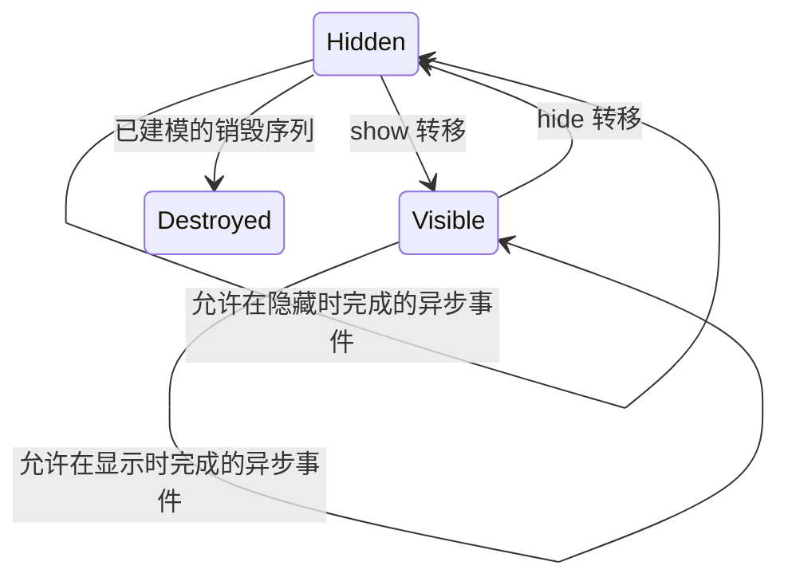

# 页面状态机是否值得实现

状态：2026-10-18，源码与语义审查后的研究判断，尚未实现或运行状态机实验。

**判断：值得做小范围的语义收益验证，尚不值得直接扩展成完整默认模型。** 预期价值首先是资源分析精度，性能收益没有依据。当前 flat 已固定采用 compact dispatcher；状态机将主动限制事件路径，属于另一项语义改动。

## 可验证的收益假设

当前 flat 将 show、hide 和 UI 事件作为全局候选事件。已知 Router Page 的 show→show、hide→点击等不符合状态约束的组合可能引入虚假覆盖/资源使用路径；hierarchical 已限制一部分 owner/Page 后继，但没有完整 Hidden/Visible 状态区分。

另一方面，不能将 show/hide 强制配为原子调用块。资源分析必须保留：

```text
show: r = open(R) → 点击: r = undefined → hide: 已无法 close(R)
show: r = open(R) → hide → 隐藏时完成的异步 close(R)
```

前者是申请后丢失句柄的缺陷见证，后者可能是正常清理。若只删除路径而没有非空缺陷/正常用例对照，无法判断告警减少来自误报改善还是漏报。

## 首个研究范围

仅研究 owner 唯一、目标明确的 Router `@Entry` Page；不先引入完整路由栈、多窗口、NavDestination 或所有组件挂载状态。官方定义中，onPageShow 对应页面显示，onPageHide 对应页面隐藏，aboutToDisappear 对应组件销毁，且生命周期中允许 Promise/异步回调；隐藏不能当成销毁或自动取消。[OpenHarmony 自定义组件生命周期](https://github.com/openharmony/docs/blob/master/zh-cn/application-dev/reference/apis-arkui/arkui-ts/ts-custom-component-lifecycle.md)



设计约束：

- **覆写方法与状态解耦。** 未实现 onPageShow/onPageHide，转移依然存在，只省略实际方法调用。页面 show/hide 只作用于适用的 Page 根，不能套到所有子组件。
- **保留对象与事实。** hide 后资源可以继续存活；show 重入或 back 返回复用原实例，不无依据重新 new、重跑 aboutToAppear 或清空字段。
- **按事件契约分类。** 点击等已确认需要可见状态的输入才受 Visible 限制；不能把所有 UIEventType、值变化、onAppear/onDisappear 和异步回调一并限制。未知情况保守可达。
- **显示与隐藏状态不混流。** 共享异步 callee 可以，但应按 `(Page, 状态, 事件)` 保持调用/返回上下文；不能让一次返回任意落入两种状态。合成 call 保留唯一正常 continuation，再分派状态后继。
- **导航不是必然成功。** 源页面继续、目标切换、失败/取消和未知目标需分别处理；未知 owner/route 继续 fallback。完整返回栈仍属后续问题。
- **资源期限交给规则。** Hidden 不是通用报告边界。只有规则明确要求隐藏时释放，才检查该义务；异步释放的截止点也不能一律固定成 onPageHide 同步返回。当前 ResourceRule 没有可见性期限字段，不能在生成器中暗加这种合同。
- **未知终止不伪造 cleanup。** 预算停止、进程被杀或无法确定的销毁顺序，不得假设 hide/release 已经执行。

## 是否推进的门槛

先准备少量有明确事件序列和资源合同的 oracle，再考虑生产实现：

| 验收项 | 必须观察到的结果 |
| --- | --- |
| 非法重复 show 造成的虚假覆盖 | 指定误报减少，且能说明被删除的是哪条非法序列 |
| show→点击丢失句柄→hide | 真实资源缺陷仍可报告 |
| hide 后异步释放 | 合法释放路径保留，不因隐藏产生新误报 |
| 无 show/hide 覆写、重复显示、back | 事件可达，接收者身份与字段事实保留 |
| 异步跨状态、导航失败、未知 owner | 不串流、不静默删掉可能路径 |
| 实际传播量和成本 | 记录合成块/边、processedEdges、事实量和耗时，不能只数 CFG |

若少量用例已能稳定减少指定误报且不损失合法缺陷路径，再在一个小型真实项目上核对；没有收益时停止扩展。真实应用实验需另行安排，不将未运行的项目当作零缺陷结果。

实验必须固定 callback/owner/route 集合、SDK、项目和规则，单独改变可见性约束，避免把 owner 补全或其他优化的收益归给状态机。不预设它能加速：状态上下文可能增加调用点、事实和摘要，回调循环也可能原本就很快饱和。
