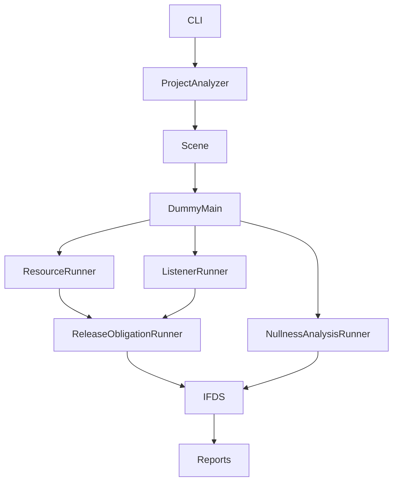

# 架构与入口

## 工程分析

ProjectAnalyzer 构建 Scene、推断类型并生成一个共同 DummyMain，再依次执行资源、listener、空指针检查。每个领域单独求解、返回状态；模块失败汇总到 errors，Scene 或生命周期构建失败属于顶层错误。

## 实现与职责

| 路径 | 职责 |
| --- | --- |
| adapter / lifecycle | IR 接口、框架方法收集与共同入口 |
| ifds | 数据流求解、ICFG、事实去重、调用返回摘要 |
| analysis/resourceleak/ResourceProblem | 句柄传播、获取、释放、所有权与出口义务 |
| analysis/resourceleak/ListenerProblem | 注册者、事件、回调/token 的取消匹配 |
| analysis/resourceleak/ListenerIdentity | 有限身份查询，不含堆保留或捕获链 |
| analysis/resourceleak/rules | SDK 资源与 listener 合同、未支持能力目录 |
| analysis/resourceleak/ReleaseObligationRunner | 共用求解编排、覆盖、证据与出口报告 |
| analysis/nullness | 独立空值事实、库摘要与补充入口 |
| application / report / cli | 工程编排、输出和参数 |

显式内存与系统资源使用同一个 ResourceRunner、默认规则集合和单次求解。ListenerRunner 复用事实传播基础，增加注册身份语义；它不分析被回调捕获的业务对象。旧 memory/closure 目录和 HeapFlow/HeapState 已移除。

## Runner 合同

ResourceRunner(scene, rules?, collectStatistics?) 与 ListenerRunner(scene, rules?, collectStatistics?) 接收现有入口并提供 runWithDummyMain(entry)。工程 API 分别使用 resourceRules / listenerRules 替代默认规则。

空指针入口保持原接口，并可分析模块初始化器等补充入口。IFDS 对回调目标的识别不等于证明回调执行时机；注册 API 不同步进入 listener 回调。资源的已建模 Promise fulfillment 仍可传播实际句柄，此类句柄传递不属于闭包保留分析。

## 边界与输出

资源和 listener 沿用可达匹配清理合同；调用事实深度为 4。成功不代表无限调用、所有异步时序或所有平台 API 已完整覆盖。当前 DummyMain 的调度精度限制见[生命周期](analysis/lifecycle.md)。

主报告 schema 为 5，analysisKind 为 arklifeguard；resourceAnalysis / listenerAnalysis 分别输出 diagnostics，摘要为 resourceLeaks / listenerLeaks。各模块显式输出 enabled/status/success/error 与覆盖。主报告省略 IFDS 统计；完整 API 和 schema 2 的 --ifds-stats 旁路报告分别保留资源/listener 统计。生命周期报告仍有独立 schema。

## 清理义务改进方案（待实现）

以下是针对条件清理、listener 传播和 owner 边界的设计建议，不描述已实现能力。分析范围仍为资源、显式内存和注册回调的清理义务，不引入 GC 或捕获对象保留分析。

### 生命周期边界与义务身份

将“哪个对象需要清理”和“谁负责、何时清理”分开表示：

| 信息 | 建议表示 | 用途 |
| --- | --- | --- |
| obligationId | 规则、获取点、有界获取上下文、抽象实例 | 区分资源或注册，清理及转交保持此身份 |
| ownerId | 组件/Ability 的抽象实例，或方法局部责任范围 | 决定由谁履行义务，不等同于注册者 |
| boundaryId | owner 的清理阶段及合成检查点 | 判断义务是否已经逾期 |
| registration | registrar、event、callback 或 timer token | 判断注销是否作用于这一项注册 |

owner 由生命周期入口上下文传给同步 helper，而不是从 callback 捕获对象推断。系统 emitter 是 registrar，注册它的页面可以是 owner。明确返回转交、字段持有和清理包装函数通过摘要传播责任；仅存入某字段不自动证明所有权已转移。多 owner、容器或外部转交无法确定时输出 unknown，不能任选一个生命周期边界。

局部获得、未转交的资源以方法结束为责任边界；由生命周期实例持有的资源和注册以对应 owner 的清理阶段为边界。普通 helper 返回不结束调用方继承的注册责任。自定义直接入口未提供生命周期元数据时，入口出口只能作为模型边界，报告需明确其依据。

在生命周期建模中为每个 owner 的清理方法正常返回及适用的异常结束后插入边界检查点，检查发生在清理完成后。即使缺少清理方法，也要存在该 owner 的结束检查点。组件消失、回收/复用与 Ability 销毁不能统一当成同一种结束；由显式生命周期策略确定本轮有效期。配置不明确时不猜测最早期限。

在边界记录该 owner 的未清理候选，再结束该有效期内的义务传播；之后其他 owner 或下一有效期的释放不能抹掉既有候选。生命周期调度需排除同一有效期结束后继续触发其事件的路径，重入/复用开启新的抽象有效期。使用有限的当前/重复实例摘要，不能加入无限递增的运行代数；同一位置重复注册无法精确区分时保留不确定性。

### 条件分支与释放异常

采用“边界仍有未清理事实”的判定，替换全局 released 集合的免报逻辑：

1. 成功获取生成 active 义务；失败获取不生成。
2. 当前路径上的匹配释放消除 active；释放其他对象或错误注册不消除。
3. 匹配释放调用的正常边和该调用自身的异常边都视为已履行该项清理义务。若处理器另行获取新对象，新对象仍有独立义务。
4. 条件分支合流采用 may-unreleased 语义：只要一条可行路径仍为 active，就保留候选，不能被兄弟分支的 released 抵消。
5. 在 owner 边界收集 active，按 owner、义务和边界去重；unknown 单独报告。最后句柄覆盖继续作为独立证据保留。

因此，`if (flag) release()` 的未执行分支应保留；`if (flag) release(); else release()` 不应报告；无条件 release 不因自身可能失败而报告。这一修改可以复用现有 IFDS 传播，不必先引入完整路径符号执行。

不可行路径仍是精度边界。第一阶段沿用已有有效性分支过滤，并报告抽象路径候选；用反例决定是否增加只针对同一义务的有限条件关联。特别需要覆盖“同一条件下获取、同一条件下释放”的用例，不能声称普通 may 分析已完整解决跨阶段条件关联。

释放前其他操作抛异常的处理尚待确定。建议第一阶段将“正常控制流绕过释放”和“释放前异常绕过释放”分别记录；前者形成常规候选，后者标记为独立异常清理风险，不直接混入默认缺少释放计数。是否默认输出后一类需进一步确定。这与忽略匹配释放调用自身异常是两项不同策略。

对于用户包装的 cleanup 方法，不可把整个方法当成无条件释放：其内部 release 仍按上述规则处理；发生在 release 前的分支或异常必须保留。异步 cleanup 必须有已建模的完成关系才能在完成边界应用清理摘要，注册/调度本身不解除义务。

### listener 传播裁剪

当前 ResourceProblem 对注册事实允许空句柄进入直接被调方法，并移除直接调用 bypass；调用帧参与事实身份。这保证 off(event) 等不依赖 callback 参数的清理可被发现，也使大量无关调用产生新事实和摘要。不能简单增加 mapped.length 非空条件。

建议先为方法建立传递效应摘要，经调用图强连通分量迭代至不动点：

| 效应 | 摘要内容 |
| --- | --- |
| create | 可能新建哪些规则的注册 |
| cancel | 可能注销哪些规则；事件、注册者、callback/token 对应的参数或字段投影 |
| modify | 可能改写相关句柄、事件或身份来源的字段/参数 |
| unknown | 未解析调用、反射、外部效应或无法表达的投影 |

“可能清理”只用于决定是否进入方法，不能当成“必然清理”的结果摘要。只有具体调用上下文和返回路径的求解结果才能消除义务。方法体、规则和调用图变化时重建摘要。

对已有注册事实：无可能匹配的 cancel、无相关 modify 且无 unknown 时，跳过被调方法并保持调用方事实；否则进入精确传播。off(event) 的无 callback 清理、字段清理和传递 helper 必须在摘要中表达。owner 边界不可被跳过。未知效应不能按无效应剪枝。

零事实独立处理：即使某方法不影响已有义务，也必须发现它及传递调用中的新注册。第一阶段保留零事实进入所有可达方法，先只裁剪非零注册事实；后续再根据 create 和 unknown 摘要裁剪零事实。

同一入口/输入事实的清理摘要可复用。优先裁剪无关调用，再评估事实中的显式 frames 是否与 IFDS incoming/end-summary 重复；不能直接去掉调用帧而破坏调用返回匹配。

清理后的事实不应再因无关调用创建新调用帧。将释放位置保存为紧凑证据或结果摘要，使后续无关语句不重复传播完整 released 事实；实施时必须保证“双方分支都清理”和“一侧未清理”仍可区分，避免 unchanged bypass 恢复已清理事实。身份查询的到达定义/前驱索引可按方法缓存，作为后续局部优化。

### 实施顺序与验收

1. 先增加 owner/boundary 元数据和可观测统计，不改变判定；统计各方法的非零事实、空句柄 call transfer、released transfer、摘要数及求解时间。
2. 实施效应摘要裁剪，保持现有合同下诊断和 API 可达覆盖一致；用无关调用链、递归调用和 off(event) helper 检查裁剪正确性。
3. 在 owner 检查点启用边界判定，移除全局释放免报；此阶段允许有依据的诊断变化，逐例核查条件分支与异常策略。
4. 最后优化 released 证据和身份查询缓存。每步只运行相关最小测试，真实项目性能实验另行确定输入和预算。

必要反例包括：条件取消、两分支均取消、释放调用抛异常、释放前异常、不同 owner 使用同事件、helper 中 off-all、缺少销毁方法、边界后才释放、重复生命周期、未知外部调用，以及 callback 构造/初始化等无关调用。阶段二应保持既有结果，阶段三按新合同验证预期差异；不能把减少事实数或增加告警数直接当作正确性提升。
