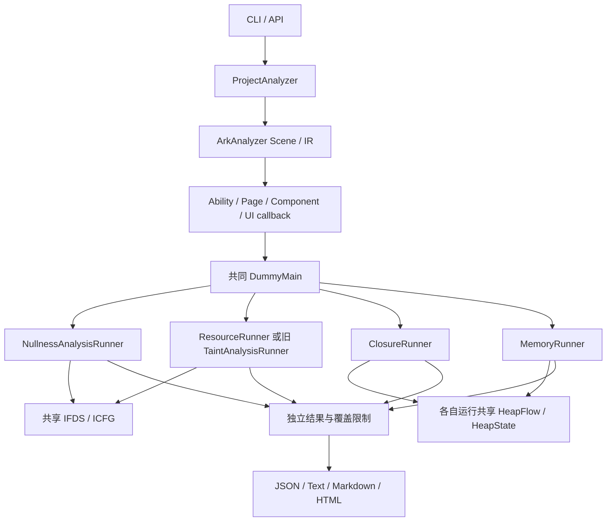

# 架构与入口

## 一次工程分析

`ProjectAnalyzer.analyze(projectPath)` 完成工程校验、SDK 发现、Scene/IR 构建、类型推断、生命周期入口生成、检查编排和完整结果装配。CLI 再将结果交给报告生成器。

工程编排只构造一次共同 DummyMain。空指针还会分析选中的模块初始化器和框架非空参数方法；其每个补充入口使用独立求解器。闭包、内存分别运行解释器，不共享可变求解状态；内存直接解析注册摘要，不读取闭包诊断。

当前执行顺序是资源、闭包、内存、空指针。已进入分析模块的失败通过独立结果和 `errors` 汇总；Scene 或生命周期构建失败属于顶层错误，无法保证剩余模块继续。

## 层与职责

| 路径 | 职责 |
| --- | --- |
| [adapter](../src/adapter/arkanalyzer.ts) | 统一导出 ArkAnalyzer 类型、IR 节点与兼容工具 |
| [lifecycle](../src/lifecycle/LifecycleModelEntry.ts) | 框架入口、owner/route、DummyMain 及模型统计 |
| [ifds](../src/ifds/DataflowSolver.ts) | 求解、ICFG、事实与摘要存储 |
| [nullness](../src/analysis/nullness/NullnessAnalysisRunner.ts) | 空值事实、流函数、解引用与库摘要 |
| [resourceleak](../src/analysis/resourceleak/ResourceRunner.ts) | 资源句柄义务、精确规则与出口诊断 |
| [closure](../src/analysis/closure/ClosureRunner.ts) | 注册义务与捕获保留诊断 |
| [memory](../src/analysis/memory/MemoryRunner.ts) | 生命周期后强引用候选及注册关联证据 |
| [shared](../src/analysis/shared/HeapFlow.ts) | 堆解释器、引用图、位置与当前规则归属辅助 |
| [application](../src/application/ProjectAnalyzer.ts) | 配置、模块编排及完整结果 |
| [report](../src/report/ReportGenerator.ts) | 只读结果并生成用户报告 |
| [cli](../src/cli/cli.ts) | 参数解析、开关和退出码 |

旧 `analysis/resource` 当前仍是默认资源路径，并被闭包/内存的支持清单引用。这是当前实际依赖，不能把目标目录结构当成已经完成的完全解耦；解除方式见[维护策略](maintenance.md)。

## Runner 契约

| Runner | 所需输入 | 实际职责 |
| --- | --- | --- |
| `NullnessAnalysisRunner(scene, config)` | Scene；可自行建模或接收 DummyMain | 创建库摘要和求解器，合并主/补充入口诊断 |
| `ResourceRunner(scene, rules?, collectStatistics?)` | Scene、DummyMain；规则可省略 | 解析默认资源规则，执行 IFDS，收集出口状态与覆盖 |
| `ClosureRunner(scene, rules?, options?)` | Scene、入口、生命周期合同 | 核对注册及捕获链，区分未取消注册与闭包保留 |
| `MemoryRunner(scene, options?, registrationRules?)` | Scene、入口、生命周期合同 | 解析根与引用链，分出注册保留关联证据 |
| 旧 `TaintAnalysisRunner` | Scene、DummyMain、Ability 方法集合 | 旧 Source/Sink IFDS 与旧结果策略 |

独立资源、闭包、内存提供 `runWithDummyMain(entry)`。空指针同时提供 `runFromDummyMain()` 和 `runWithDummyMain(entry)`：前者负责生成入口，后者接收现有模型。这是两种入口使用方式，不是必须保留的历史兼容层。

闭包/内存的 `HeapFlowOptions.lifetimes` 指定类签名与终点方法签名。工程编排从已收集 Ability/Component 提供 `onDestroy` / `aboutToDisappear`。直接使用 Runner 时，单凭方法名字或任意 return 不会建立寿命合同。

## 求解边界

资源与空指针的问题域满足各自 IFDS 事实传播契约，复用 `DataflowSolver`。堆存储、清空和引用更新依赖完整状态，闭包/内存使用路径状态解释器，而不是将资源事实换一个类别标签。

ICFG 的调用目标解析可能识别回调方法，但识别目标不等于证明其执行时机。领域摘要必须处理异步不确定性；注册摘要不会将回调当作普通同步调用执行。

位置可能来自合成语句。此时诊断使用显式 `[synthetic]` 或可用的源码回退位置；不能把合成分配点描述为真实源码分配。

## 输出契约

完整 API 为 `ProjectAnalysisResult`，包含配置、各模块结果、生命周期信息和耗时。主报告为精简视图，保留模块状态、候选、证据及覆盖限制。两者字段范围不同。

当前主报告 schema 为 2；`analysisKind` 固定字面值、旧资源结果块和零值摘要仍存在。旁路生命周期/旧 IFDS 统计报告有各自 schema，不必与主报告同号。模块语义与状态是解释数量的前提，不能只汇总数组长度。
