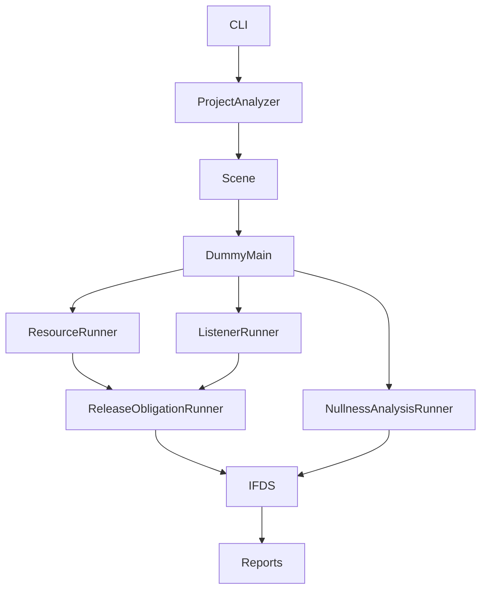

# 架构与入口

## 工程分析

ProjectAnalyzer 构建 Scene、推断类型并生成一个共同 DummyMain，再依次执行资源、listener、空指针检查。每个领域单独求解、返回状态；模块失败汇总到 errors，Scene 或生命周期构建失败属于顶层错误。

## 实现与职责

| 路径 | 职责 |
| --- | --- |
| adapter / lifecycle | IR 接口、框架方法收集与共同入口 |
| ifds | 数据流求解、ICFG、事实去重、调用返回摘要 |
| analysis/resourceleak/ResourceProblem | 句柄传播、获取、释放、所有权与出口义务 |
| analysis/resourceleak/ListenerProblem | 注册者、事件、回调/token 的取消匹配 |
| analysis/resourceleak/ListenerIdentity | 有限身份查询，不含堆保留或捕获链 |
| analysis/resourceleak/rules | SDK 资源与 listener 合同、未支持能力目录 |
| analysis/resourceleak/ReleaseObligationRunner | 共用求解编排、覆盖、证据与出口报告 |
| analysis/nullness | 独立空值事实、库摘要与补充入口 |
| application / report / cli | 工程编排、输出和参数 |

显式内存与系统资源使用同一个 ResourceRunner、默认规则集合和单次求解。ListenerRunner 复用事实传播基础，增加注册身份语义；它不分析被回调捕获的业务对象。旧 memory/closure 目录和 HeapFlow/HeapState 已移除。

## Runner 合同

ResourceRunner(scene, rules?, collectStatistics?) 与 ListenerRunner(scene, rules?, collectStatistics?) 接收现有入口并提供 runWithDummyMain(entry)。工程 API 分别使用 resourceRules / listenerRules 替代默认规则。

空指针入口保持原接口，并可分析模块初始化器等补充入口。IFDS 对回调目标的识别不等于证明回调执行时机；注册 API 不同步进入 listener 回调。资源的已建模 Promise fulfillment 仍可传播实际句柄，此类句柄传递不属于闭包保留分析。

## 边界与输出

资源和 listener 沿用可达匹配清理合同；调用事实深度为 4。成功不代表无限调用、所有异步时序或所有平台 API 已完整覆盖。当前 DummyMain 的调度精度限制见[生命周期](analysis/lifecycle.md)。

主报告 schema 为 5，analysisKind 为 arklifeguard；resourceAnalysis / listenerAnalysis 分别输出 diagnostics，摘要为 resourceLeaks / listenerLeaks。各模块显式输出 enabled/status/success/error 与覆盖。主报告省略 IFDS 统计；完整 API 和 schema 2 的 --ifds-stats 旁路报告分别保留资源/listener 统计。生命周期报告仍有独立 schema。
